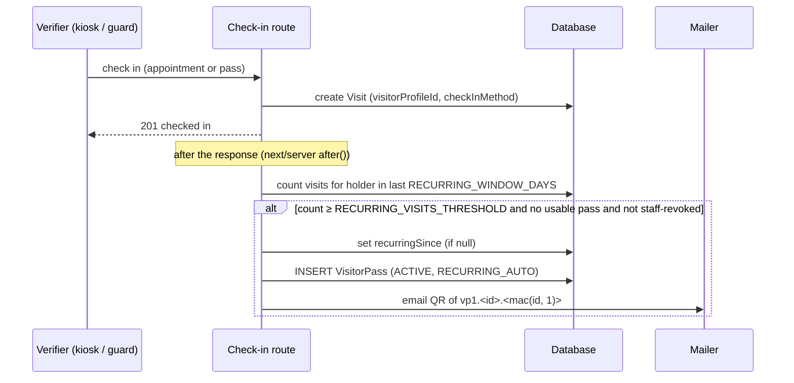
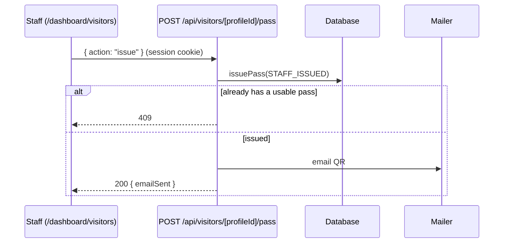
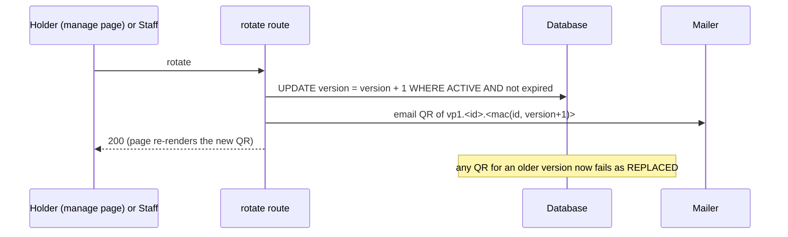

# Visitor passes — a portable bearer-credential mechanism

This document describes the visitor pass as built in this Visitor Management
System (VMS), written so the same mechanism can be rebuilt elsewhere — for
example as a membership card. It assumes no knowledge of this codebase.

The mechanism in neutral terms:

- A **holder** is a person with a record in your system.
- A **pass** is a database row that grants one holder a credential.
- The **token** is the string inside the pass's QR code. It is derived from the
  pass, never stored.
- A **verifier** is whatever reads the QR and decides whether to admit the
  holder.

| Neutral term | In this app | Where |
| --- | --- | --- |
| Holder | Visitor profile (`VisitorProfile`: one email + name pair) | `prisma/schema.prisma` |
| Pass | `VisitorPass` row | `prisma/schema.prisma` |
| Issuer (scope) | The organization — one per deployment today | see `MULTI_TENANCY_TODO.md` |
| Token | `vp1.<passId>.<mac>` in the QR | `src/lib/pass-token.ts` |
| Verifier | The kiosk (`/check-in/appointment`) or a guard's scanner (`/dashboard/scan`) | `src/components/appointment-check-in.tsx` |
| Issuing automatically | Reaching the recurring-visit threshold | `evaluateRecurringVisitor()` in `src/lib/visitor-pass.ts` |
| Issuing manually | Staff, from `/dashboard/visitors` | `POST /api/visitors/[profileId]/pass` |
| Holder self-service | "My pass" on `/appointment-booking/manage` | `src/app/appointment-booking/manage/` |

---

## 1. Purpose and trust model

### Booking another visit with a pass

On the booking page, **I've been here before** opens a visitor pass QR lookup.
Scan a pass or paste its full `vp1.<passId>.<mac>` QR ID, then continue directly
to choosing the visit with the saved name, email and phone prefilled. A bare
pass ID or an appointment QR is not accepted. **I don’t have my QR ID — use
name and email** opens the existing emailed-code flow.

`POST /api/booking/pass/verify` validates the signed, active, unexpired pass
before returning profile details. A 30-minute httpOnly cookie is scoped to
`/api/appointments`; the pass is validated again before linking the booking,
so rotation, revocation or expiry between lookup and submit requires another
lookup. Booking does not renew the pass or record a visit. The cookie is
cleared after booking and on sign-out. It grants booking prefill only; the
appointment manage page continues to require its existing email verification
or an appointment's signed manage link.

### Development without Resend

Missing `RESEND_API_KEY` or `APPOINTMENT_FROM_EMAIL` queues pass mail for retry.
**Send QR** queues the current code without rotating the pass. The admin email
log shows failures and supports manual retries. Tests set `EMAIL_MODE=test` to
record SENT messages without contacting Resend; inline QR attachments remain
available in the isolated test outbox. Pass tokens and QR credentials are never
printed to application logs. See [email operations](./robustness.md).

### What a pass proves

A pass is a **bearer credential, like a ticket**: whoever presents the QR is
treated as the holder. It exists so a returning visitor can check in with one
scan instead of filling in a form.

**What a valid scan proves:** the QR was produced by this system (only the
server knows the secret), for this pass id, at the pass's *current* version,
and the pass is still active and unexpired.

**What it does not prove:** that the person holding the phone or the printout
*is* the holder. Anyone with a copy — a forwarded email, a photo, a screenshot —
passes the check. For check-in, a guard is present to look at the person. The
booking page also accepts a valid pass as proof to retrieve that profile's
saved details and link a new booking. Possession does not grant access to
appointment management.

If your setting needs proof of identity rather than possession, a pass alone is
not enough — see [Security notes](#6-security-notes).

---

## 2. Token format and derivation

```
token   = "vp1" + "." + passId + "." + mac
message = "vp1" + "." + passId + "." + decimal(version)
mac     = base64url_nopad( HMAC_SHA256(key = PASS_SECRET, data = message) )
```

- `vp1` is a fixed prefix: the format version, and how a scanner tells a pass
  from any other QR content (in this app, appointment QRs are bare UUIDs).
- `passId` is the row's id: 8–64 characters of `[A-Za-z0-9_-]` (this app uses
  cuids). It is in the token so the verifier knows which row to load.
- `version` is a positive integer stored on the row. It is **not** in the
  token: the verifier looks it up and recomputes. Bumping it changes the mac,
  which invalidates every token minted before.
- `mac` is the 32-byte HMAC-SHA256, base64url without padding: always 43
  characters.

**Verifying:**

```
parse(token):
  reject unless token (trimmed) is ≤ 200 chars, splits on "." into exactly 3 parts,
  part[0] == "vp1", part[1] matches [A-Za-z0-9_-]{8,64}, part[2] matches [A-Za-z0-9_-]{43}

verify(token, secret, currentVersion):
  { passId, mac } = parse(token)            -- MALFORMED if parse fails
  expected = mac_for(passId, currentVersion, secret)
  constant_time_equal(expected, mac)        -- BAD_MAC if not
```

In `src/lib/pass-token.ts` this is:

```ts
signPassToken({ passId, version, secret }): string
parsePassToken(token): { passId, mac } | null
verifyPassToken(token, secret, version): { ok: true, passId } | { ok: false, reason: "MALFORMED" | "BAD_MAC" }
isPassToken(value): boolean                 // prefix check only
renderPassQrPng(token): Promise<Buffer>
renderPassQrDataUrl(token): Promise<string>
```

`verifyPassToken` takes the version as a third argument because the version
lives in your database, not in the token. Secrets shorter than 32 characters
are refused (the functions throw).

### Worked example

With the **dummy** secret `dummy-secret-for-docs-0123456789abcdef` (never use
it for real), pass id `clxpass0example0001`, version 1:

```
message  = vp1.clxpass0example0001.1
HMAC hex = 7dfe5314f48f5ac01e17b780b4c549d3da6fe15aeab57f124598a876105f198b
token    = vp1.clxpass0example0001.ff5TFPSPWsAeF7eAtMVJ09pv4VrqtX8SRZiodhBfGYs
```

After a rotate (version 2) the same pass's token becomes
`vp1.clxpass0example0001.AA1RyXoxgQo3-Ph810zX1gUi_280w6K9kEH4wBfAkfY`, and
`verifyPassToken(<v1 token>, secret, 2)` returns `{ ok: false, reason: "BAD_MAC" }`.

You can reproduce the mac with any HMAC tool, e.g.
`node -e 'console.log(require("crypto").createHmac("sha256","<secret>").update("vp1.<passId>.<version>").digest("base64url"))'`.

---

## 3. Data model

```prisma
enum VisitorPassStatus { ACTIVE  REVOKED }
enum PassIssueReason   { RECURRING_AUTO  STAFF_ISSUED }

model VisitorPass {
  id              String            @id @default(cuid())
  profileId       String
  profile         VisitorProfile    @relation(fields: [profileId], references: [id], onDelete: Cascade)
  version         Int               @default(1)
  status          VisitorPassStatus @default(ACTIVE)
  issueReason     PassIssueReason
  issuedAt        DateTime          @default(now())
  expiresAt       DateTime
  lastUsedAt      DateTime?
  revokedAt       DateTime?
  revokedByUserId String?
  revokedBy       User?             @relation(fields: [revokedByUserId], references: [id], onDelete: SetNull)

  @@index([profileId])
  @@index([revokedByUserId])
  @@map("visitor_pass")
}
```

| Field | Meaning |
| --- | --- |
| `id` | The pass id inside the token. Random (cuid), so it reveals nothing about other rows. |
| `profileId` | The holder. Deleting the profile deletes its passes. |
| `version` | Part of the signed message. Rotate = `version + 1`. |
| `status` | `ACTIVE` or `REVOKED`. **Expiry is not a status** — it is read from `expiresAt`, so renewing on use needs no state change. |
| `issueReason` | `RECURRING_AUTO` (threshold reached) or `STAFF_ISSUED`. |
| `issuedAt` | When the row was created. |
| `expiresAt` | The pass stops working after this. Pushed forward on every use. |
| `lastUsedAt` | Last successful check-in with it. |
| `revokedAt`, `revokedByUserId` | Who withdrew it and when. `revokedByUserId` null means the system retired it (an expired pass replaced by a new one) or the staff account is gone. |

**Constraint not expressible in Prisma — at most one ACTIVE pass per holder:**

```sql
CREATE UNIQUE INDEX "visitor_pass_one_active_per_profile"
  ON "visitor_pass" ("profileId") WHERE "status" = 'ACTIVE';
```

It lives in the migration `prisma/migrations/20261012090000_visitor_passes/`.
Prisma's drift check leaves it alone. Concurrent issuance relies on it: the
second insert fails with a unique violation, which `issuePass()` turns into
"already has one".

Related fields this app added (not part of the portable core):
`Visit.visitorProfileId` (which holder a visit belongs to — what the recurring
count reads), `Visit.checkInMethod` (`WALK_IN | APPOINTMENT | DELIVERY | PASS`),
and `VisitorProfile.recurringSince`.

---

## 4. Lifecycle

All in `src/lib/visitor-pass.ts` unless noted.

| Step | Rule | Function |
| --- | --- | --- |
| **Issue** | Only if the holder has no usable pass. An ACTIVE pass past `expiresAt` is first set to REVOKED (system), so the new one can take the single ACTIVE slot. `expiresAt = now + PASS_VALID_DAYS`, `version = 1`. A race is resolved by the partial unique index. Returns `issued` or `already-active`. | `issuePass(profileId, { reason, actorUserId })` |
| **Issue automatically** | After every check-in linked to a holder: if the holder has ≥ `RECURRING_VISITS_THRESHOLD` linked visits within `RECURRING_WINDOW_DAYS`, set `recurringSince` (once) and, unless the holder has a usable pass **or their latest pass was revoked by staff**, issue `RECURRING_AUTO` and email it. Never throws. | `evaluateRecurringVisitor(profileId)` |
| **Validate** | Parse → load row by id → mac must match the row's *current* version → status must be ACTIVE → `expiresAt` must be in the future. A genuine token for an older version is classified REPLACED; anything else that fails the mac is INVALID. | `validatePass(token)` |
| **Renew on use** | After a successful check-in: `lastUsedAt = now`, `expiresAt = now + PASS_VALID_DAYS`. Guarded on ACTIVE so a pass revoked mid-scan is not revived. | `recordPassUse(passId)` |
| **Rotate** | ACTIVE and unexpired only: `version + 1`. Every earlier QR stops working at once; the new QR is shown/emailed. | `rotatePass(passId)` |
| **Revoke** | ACTIVE only: `status = REVOKED`, `revokedAt`, `revokedByUserId`. Permanent. | `revokePass(passId, userId)` |
| **Expire** | Implicit: `expiresAt ≤ now` fails validation. No job runs. | `validatePass()` |

Rendering is not a lifecycle step: `tokenForPass(pass)` and `passQrDataUrl(pass)`
recompute the token from `id` + `version` every time, so the QR on the manage
page, in the email and in a re-sent email are byte-identical until a rotate.

---

## 5. Sequence diagrams

### Automatic issuance



### Manual issuance (staff)



### Scanning

```mermaid
sequenceDiagram
  participant H as Holder
  participant K as Verifier UI
  participant R as POST /api/passes/resolve
  participant C as POST /api/appointments/check-in<br/>or /api/passes/walk-in
  participant DB as Database
  H->>K: shows QR
  K->>K: starts with "vp1."? → pass flow
  K->>R: { token }
  R->>DB: load pass by id; verify mac @ current version; ACTIVE; not expired
  alt invalid / replaced / revoked / expired
    R-->>K: 403 "This pass is no longer valid. Please ask the guard for help."
  else valid
    R->>DB: holder's PENDING appointments inside the check-in window
    R-->>K: holder name + 0, 1 or n appointments (+ recent host/purpose if 0)
    K->>C: { reference, passToken } or { token, hostId, purposeId }
    C->>DB: re-validate pass; create Visit (method PASS, holder linked)
    C->>DB: recordPassUse (lastUsedAt, renew expiresAt)
    C-->>K: 201
  end
```

### Rotation



---

## 6. Security notes

- **Constant-time comparison.** `verifyPassToken` compares macs with
  `crypto.timingSafeEqual`. Both buffers are 43 bytes by construction, so the
  comparison never throws and leaks nothing through timing.
- **Authenticity before disclosure.** `validatePass` checks the mac before it
  looks at status or expiry, and every refusal returns the same 403 and
  message. A scan cannot be used to learn which pass ids exist or which were
  revoked.
- **Why the token isn't stored.** Nothing in the database can be stolen and
  replayed: a leaked `visitor_pass` table yields ids and versions but no valid
  tokens without the secret. It also means the QR can be re-rendered at any
  time, identically, and killed by a single integer update.
- **`PASS_SECRET` handling.** Server-only environment variable, at least 32
  characters (generate with
  `node -e "console.log(require('crypto').randomBytes(32).toString('base64url'))"`).
  Application logs retain pass ids and refusal reasons without QR credentials.
  **Rotating
  the secret invalidates every pass at once.** To rotate without a flag day, you
  would add a second secret and accept either in `validatePass` during a
  transition (not implemented here). Use a different secret per environment.
- **Forwarded or photographed passes** work for whoever holds them, until the
  pass is rotated or revoked. Mitigations in this app: a guard is present at
  every verifier, a pass only checks the holder into *their own* appointments or
  a walk-in under *their own* name, the email and manage page tell the holder
  to keep it private, and the holder can "Replace my pass" themselves.
- **Expiry choice.** `PASS_VALID_DAYS = 365`, renewed on every use, so active
  holders never see it expire and abandoned passes die after a year of
  silence. Shorten it for higher-risk settings; set a fixed end date (no
  renewal) if passes must lapse on schedule (e.g. a paid term).
- **For a higher-risk setting, add:** rate limits per pass id on scans (this
  app only limits per terminal IP: 30 lookups and 20 check-ins per minute);
  device binding (store a public key at issuance and require a signed
  challenge, i.e. a wallet pass or app rather than a static QR); a second
  factor at the verifier (photo on file, PIN, or ID check); short-lived
  rotating QR codes (TOTP-style, re-derived every 30 s by an app); an audit log
  of every scan, successful or not.

---

## 7. Environment variables and config constants

| Name | Where | Default | Meaning |
| --- | --- | --- | --- |
| `PASS_SECRET` | `.env` | none (required) | HMAC key for pass tokens, ≥ 32 chars. `passSecret()` throws if unset. |
| `PASS_VALID_DAYS` | `src/lib/booking-config.ts` | `365` | Lifetime from issue, and from each use. |
| `RECURRING_VISITS_THRESHOLD` | `src/lib/booking-config.ts` | `3` | Linked visits needed for automatic issuance. |
| `RECURRING_WINDOW_DAYS` | `src/lib/booking-config.ts` | `30` | Look-back window for the threshold. |
| `CHECK_IN_EARLY_MINUTES` | `src/lib/booking-config.ts` | `60` | How early before an appointment a scan (pass or appointment QR) may check in. |
| `STAFF_PROFILE_LIMIT` | `src/lib/visitor-pass.ts` | `100` | Rows shown on `/dashboard/visitors` before searching. |
| `PASS_TOKEN_PREFIX` | `src/lib/pass-token.ts` | `"vp1"` | Token format version and scanner discriminator. |

---

## 8. Edge cases

Every pass refusal shows the same message — `PASS_FAILURE_MESSAGE` in
`src/lib/visitor-pass.ts` — and the internal reason is only logged:

| Case | Internal reason | Holder sees |
| --- | --- | --- |
| Garbled, forged, tampered, wrong secret, unknown id | `INVALID` | This pass is no longer valid. Please ask the guard for help. |
| Revoked | `REVOKED` | This pass is no longer valid. Please ask the guard for help. |
| Expired | `EXPIRED` | This pass is no longer valid. Please ask the guard for help. |
| Replaced (QR from before a rotate) | `REPLACED` | This pass is no longer valid. Please ask the guard for help. |

Other cases:

- **Valid pass, one appointment in the check-in window** → the normal
  "Is this you?" confirmation, then check-in recorded as `PASS`.
- **Several appointments in the window** → a picker, then the same.
- **None** → "No appointment today" with an express walk-in: name prefilled
  from the holder, "Same as last time" cards (up to 3 most recent distinct
  host + purpose pairs still selectable), and a host/purpose fallback. If there
  is an appointment later today, it says when check-in opens
  ("Your appointment is today at 2:04 PM. Check-in opens at 1:04 PM.").
- **A pass presented with someone else's appointment reference** → 404, as if
  the appointment did not exist.
- **Two check-ins finishing at once** for a holder at the threshold → exactly
  one pass (partial unique index).
- **Staff revoked the pass** → automatic issuance does not replace it; only
  staff can issue another.
- **Pass expired but still ACTIVE in the table** → validation refuses it; the
  next issuance (automatic or staff) retires it and creates a fresh pass.
- **Holder opens the manage page through an appointment email link** → no pass
  shown; "My pass" requires signing in with the emailed code.
- **Email not configured / fails** → the pass still exists; the holder sees it
  on the manage page after signing in. The failure is logged.

---

## 9. Test checklist

Automated (pure module): `npm run test:pass-token` runs `tests/pass-token.test.ts`
— round trip, determinism, tampered id, tampered mac, wrong secret, wrong
version, malformed and empty input, non-string input, short secret, bad ids.

The following end-to-end checks were reported in the 2026-10-12 scripted
verification session. They are historical results, not a claim that this
session reran the browser or mail-provider checks:

- [x] Third linked visit within the window issues exactly one pass, sets
      `recurringSince`, sends the email; a fourth does not issue another.
- [x] Scan with one appointment → confirm → check-in; visit has
      `checkInMethod = PASS`, the holder's `visitorProfileId`, the guard's id
      when scanned on the guard page.
- [x] Scan with several → picker; the unpicked one is still offered next scan.
- [x] Scan with none → express walk-in with the holder's name and recent
      choices; `lastUsedAt` set, `expiresAt` renewed.
- [x] A pass cannot redeem someone else's appointment.
- [x] Rotated (by holder and by staff), revoked, expired and tampered passes
      are refused with the exact message.
- [x] The QR on the manage page is identical across renders and equals the QR
      of the independently derived token.
- [x] Recurring count includes appointment and pass check-ins.
- [x] A second ACTIVE pass for one holder is refused by the database.
- [x] `src/lib/pass-token.ts` imports only `node:crypto` and `qrcode`.

Current automated regression coverage includes `tests/pass-token.test.ts`,
`tests/pass-email.test.ts`, and `tests/booking-pass.test.ts`. The scripted
HTTP check is `npm run test:http:booking-pass`. Full suite execution and
interactive camera verification are still pending; see
[CONTINUATION.md](../CONTINUATION.md).

---

## 10. Adapting this

**Copy unchanged:**

- `src/lib/pass-token.ts` — no database, framework or app imports.
- `tests/pass-token.test.ts` — imports the module by relative path.

Change `PASS_TOKEN_PREFIX` only if you want a different discriminator (e.g.
`mb1` for members) — the prefix is part of the signed message, so tokens from
the two systems can never be confused.

**Rewrite for your project:**

- The schema: a pass table with the fields in [Data model](#3-data-model),
  pointing at your holder table, plus the partial unique index.
- The service layer, modelled on `src/lib/visitor-pass.ts`: `passSecret`,
  `issuePass`, `validatePass`, `recordPassUse`, `rotatePass`, `revokePass`.
  Keep "authenticity before disclosure" and "one message for every refusal".
- Verifier routes, modelled on `src/app/api/passes/resolve/route.ts`.

**Specific to this app (leave behind or replace):**

- Recurring-visit issuance (`evaluateRecurringVisitor`, `countRecentVisits`,
  `Visit.visitorProfileId`, `recurringSince`).
- Kiosk express check-in (appointment matching via `findPassAppointments` in
  `src/lib/appointments.ts`, "Same as last time" via `recentVisitChoices`,
  `createWalkInVisit` in `src/lib/visits.ts`).
- The returning-visitor sign-in used for "My pass" (emailed 6-digit code,
  `src/lib/booking-verification.ts`).

**For a membership use case:**

- *Issue at signup* (or on first payment) instead of after N visits: call your
  `issuePass` from the signup flow; drop the recurring logic.
- *Tie expiry to the subscription*: set `expiresAt` to the end of the paid
  period and **don't** renew on use; on renewal, extend `expiresAt`; on
  cancellation or non-payment, revoke (or let it lapse). Validation also
  checking the live subscription status is cheap and closes the gap between a
  missed payment and the expiry date.
- *Tiers*: keep the tier on the member (or the pass row) and return it from
  validation; the token does not need to change. Don't put the tier in the
  token unless you want a tier change to require re-issuing.
- *Member lookup on scan*: `validatePass` already returns the holder; show the
  verifier name, photo and tier so a human can match face to card, and log the
  scan.
- *Several cards per member* (family members, a phone and a printed card):
  relax the one-ACTIVE-per-holder index to one per (holder, device/label), and
  revoke them individually.
